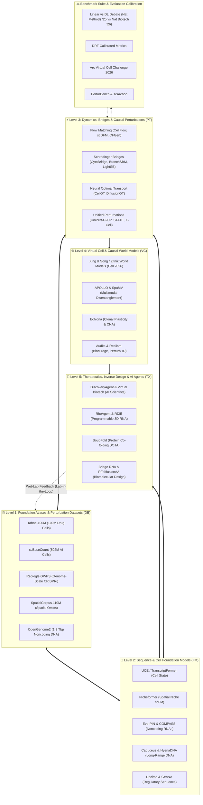
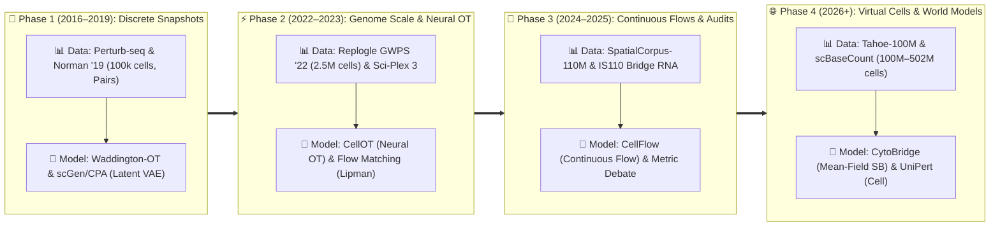

# 🧬 Awesome Virtual Cell, Perturbation Biology & AI4Bio (2026)

**A curated, chronologically ordered (2026 $\to$ 2023) research hub for Virtual Cells, Single-Cell Perturbation Prediction, Genomic & Single-Cell Foundation Models, AI × RNA Design, and Multi-Agent Scientific Discovery.**

---

## 🗺️ Research Ecosystem & Knowledge Graph

---

## ⏳ Evolution Timeline: Co-Development of Datasets & AI Paradigms (2016 – 2026)

The virtual cell and perturbation biology field has evolved through **four distinct historical epochs**, driven by the synchronized scaling of **experimental screening throughput** and **generative mathematical mechanics**:

| Era | Key Dataset & Assay Milestones | AI & Computational Paradigm Milestones | Core Paradigm Shift & Theoretical Leap |
| :---: | :--- | :--- | :--- |
| **2016–2019** *Discrete Snapshots* | **Perturb-seq** (Adamson / Dixit '16, 100k cells) **Norman 2019** (284 CRISPRa pairs) | **Waddington-OT** (Schiebinger '19, Static OT) **scGen / CPA** (Lotfollahi '19–'21, Latent VAEs) | From bulk screens to single-cell resolution; latent vector addition in autoencoders models cell shifts. |
| **2022–2023** *Genome-Scale & Neural OT* | **Replogle 2022** (Genome-Wide CRISPRi, 2.5M cells) **Sci-Plex 3** (188 compounds, 650k cells) | **CellOT** (Bunne / Theis, *ICML '23 Oral*) **Flow Matching** (Lipman et al., *ICLR '23 Oral*) | Scaled to whole genomes; Neural Optimal Transport & simulation-free straight-line ODE flows replace discrete matching. |
| **2024–2025** *Continuous Flows & Reality Checks* | **SpatialCorpus-110M** (73 spatial datasets) **IS110 Bridge RNA** (Arc / *Nature '24*) | **CellFlow** (Theis, *Nat. Methods '25*) **Linear vs DL Debate** (*Nat. Methods '25*) | Shift from autoencoders to continuous probability flow matching; critical discovery of variance miscalibration in benchmarks. |
| **2026+** *Virtual Cells & World Models* | **Tahoe-100M** (*Cell*, 100M drug cells) **scBaseCount** (*Cell*, 502M curated cells) **Arc Virtual Cell Challenge 2026** | **CytoBridge** (Unbalanced Mean-Field SB) **UniPert-G2CP** (*Cell*, Genetic-to-Chemical Transfer) **Evo-PIN** (Arc, 5.14M ncRNA clusters) **DiscoveryAgent** (Stanford, Audit Agents) | **The Virtual Cell Era**: Multi-agent AI scientists, mean-field physics integrating cell-cell interactions, and unified cause-effect spaces. |

---

## 📂 Taxonomy & Repository Structure

All works are organized into **5 core research pillars**, with papers inside each section sorted **newest-first (2026 $\to$ 2023)**:

| Code | Category | Focus |
| :---: | :--- | :--- |
| **`PT`** | **Perturbation & Cellular Dynamics** | Perturb-seq response prediction, Optimal Transport, Flow Matching, Schrödinger & Brownian Bridges |
| **`FM`** | **Foundation Models (scFM & gLM)** | Single-cell & spatial foundation models, DNA/RNA language models |
| **`VC`** | **Virtual Cell & World Models** | Theoretical frameworks, multimodal cell state disentanglement, causal world models, audits |
| **`DB`** | **Benchmarks & Large-Scale Atlases** | Standardized perturbation benchmarks, 100M+ cell atlases, AI-curated repositories |
| **`TX`** | **Therapeutics, RNA Design & AI Agents** | Programmable RNA/protein design, lab-in-the-loop, multi-agent drug discovery |

---

## 📑 Table of Contents

- [⏳ Evolution Timeline: Datasets vs. AI Paradigms (2016 – 2026)](#-evolution-timeline-co-development-of-datasets--ai-paradigms-2016--2026)
- [1. Perturbation & Cellular Dynamics (`PT`)](#1-perturbation--cellular-dynamics-pt)
  - [1.1 Optimal Transport, Flow Matching & Bridges (Sorted by Year)](#11-optimal-transport-flow-matching--bridges-sorted-by-year)
  - [1.2 Large-Scale & Causal Perturbation Prediction (Sorted by Year)](#12-large-scale--causal-perturbation-prediction-sorted-by-year)
  - [1.3 Lab-in-the-Loop & Inverse Cell Fate Design (Sorted by Year)](#13-lab-in-the-loop--inverse-cell-fate-design-sorted-by-year)
- [2. Foundation Models: Single-Cell, Spatial & Genomics (`FM`)](#2-foundation-models-single-cell-spatial--genomics-fm)
  - [2.1 Single-Cell & Spatial Foundation Models (Sorted by Year)](#21-single-cell--spatial-foundation-models-sorted-by-year)
  - [2.2 Genomic & RNA Language Models (Sorted by Year)](#22-genomic--rna-language-models-sorted-by-year)
- [3. Virtual Cell & World Models (`VC`)](#3-virtual-cell--world-models-vc)
  - [3.1 World Models & Theoretical Perspectives](#31-world-models--theoretical-perspectives)
  - [3.2 Multimodal Disentanglement & Cell-Cell Communication](#32-multimodal-disentanglement--cell-cell-communication)
  - [3.3 Critical Evaluations & Reality Checks](#33-critical-evaluations--reality-checks)
- [4. Benchmarks & Large-Scale Atlases (`DB`)](#4-benchmarks--large-scale-atlases-db)
- [5. Therapeutics, RNA/Protein Design & AI Agents (`TX`)](#5-therapeutics-rnaprotein-design--ai-agents-tx)
- [6. Arc 2026 Virtual Cell Challenge: Top-7 Takeaways](#6-arc-2026-virtual-cell-challenge-top-7-takeaways)
- [7. 📊 Benchmark & Atlas Datasets Registry](#7--benchmark--atlas-datasets-registry)
  - [7.1 Single-Cell Genetic Perturbations (CRISPR / Perturb-seq)](#71-single-cell-genetic-perturbations-crispr--perturb-seq)
  - [7.2 Chemical & Small-Molecule Perturbations (High-Throughput Screens)](#72-chemical--small-molecule-perturbations-high-throughput-screens)
  - [7.3 Spatiotemporal Single-Cell Dynamics (Spatial Omics)](#73-spatiotemporal-single-cell-dynamics-spatial-omics)
  - [7.4 Massive Observational Atlases & Lineage Tracing](#74-massive-observational-atlases--lineage-tracing)
  - [7.5 Genomics & Metagenomic Sequence Corpora](#75-genomics--metagenomic-sequence-corpora)
- [8. Standardized Benchmark Suites & APIs](#8-standardized-benchmark-suites--apis)

---

## 1. Perturbation & Cellular Dynamics (`PT`)

### 1.1 Optimal Transport, Flow Matching & Bridges (Sorted by Year)

| Year | Paradigm | Method / Title | Venue | Benchmark / Key Dataset | Core Idea & Mechanism | Link / DOI |
| :---: | :---: | :--- | :--- | :--- | :--- | :--- |
| **2026** | `SB` | **CytoBridge**: Spatiotemporal cell dynamics | bioRxiv | MOSTA Stereo-seq, Xenium AD, ARTISTA Axolotl, Chick Heart Visium | Unbalanced mean-field Schrödinger bridge decomposing cell velocity into L-R interaction & intrinsic regulation | [bioRxiv](https://www.biorxiv.org/content/10.64898/2026.11.04.764438) |
| **2026** | `OT` | **SCALE**: Scalable Conditional Endpoint Transport | bioRxiv | Atlas-scale scRNA-seq, CELLxGENE | Scalable conditional endpoint transport for atlas-level virtual cell perturbation | [DOI](https://doi.org/10.64898/2026.03.17.712536) |
| **2026** | `Diff` | **PerturbDiff**: Functional Diffusion | *NeurIPS* / arXiv | Norman 2019, Adamson 2016 | Functional diffusion in Hilbert space (RKHS) capturing transcriptional escapers | [arXiv:2602.19685](https://arxiv.org/abs/2602.19685) |
| **2026** | `SB` | **Benchmark for Discrete Schrödinger Bridges** | *ICLR* | Discrete biological graphs & sequences | Evaluates discrete Schrödinger bridges (`DLightSB`) on discrete sequence/graph spaces | OpenReview |
| **2025** | `FM` | **CellFlow**: Flow matching phenotype model | *Nat. Methods* / bioRxiv | Sci-Plex 3, LARRY barcoded hematopoiesis | Continuous flow matching for high-dimensional perturbation distribution mapping | [bioRxiv](https://www.biorxiv.org/content/10.1101/2025.04.11.648220) |
| **2025** | `SB` | **BranchSBM**: Branched Schrödinger Bridge Matching | *ICLR* | Hematopoietic lineage bifurcation trees, Paul 2015 | Extends Schrödinger bridge to tree-like bifurcations (cell fate decision trees) | [OpenReview](https://openreview.net/) |
| **2025** | `FM` | **SP-FM**: Shortest-Path Flow Matching | *ICLR* | Norman 2019, scPerturb OOD splits | Conditional shortest-path base distributions on manifolds for OOD perturbation generalization | OpenReview |
| **2025** | `FM` | **Discrete Flow Matching (DFM) for Regulatory DNA** | *ICLR* | MPRA promoter/enhancer activity assays | Discrete flow matching on nucleotide sequences for promoter/enhancer design | OpenReview |
| **2025** | `BB` | **The $\varepsilon$-Bridge**: Bridge-Noise Selection | *ICLR Spotlight* | Stochastic interpolant benchmarks | Analyzes when Brownian bridge noise outperforms deterministic flow matching | OpenReview |
| **2024** | `FM` | **scDFM**: Distributional Flow Matching | *ICLR* | Norman 2019, Adamson 2016 | Conditional flow matching + MMD for full-distribution perturbation modeling | OpenReview |
| **2024** | `FM` | **cellFlow / CFGen**: Flow on single-cell counts | *ICLR* | 10x PBMC, paired scRNA+scATAC count space | Continuous flow modeling directly in discrete Negative Binomial count space | OpenReview |
| **2024** | `OT` | **SC-OTGM**: Optimal Transport on GM Manifolds | *ICLR Spotlight* | Norman 2019, Gaussian mixture simulations | Fast optimal mass transport solved on Gaussian mixture manifolds | OpenReview |
| **2024** | `SB` | **Light Schrödinger Bridge** | *ICLR Spotlight* | Single-cell embryoid body (EB) timecourse | Simulation-free lightweight SB solver via sum-exp quadratic potentials | OpenReview |
| **2024** | `SB` | **Deep Generalized Schrödinger Bridge** | *ICLR* | Mean-field game simulations, high-dim transport | Nonlinear mean-field Schrödinger bridges (theoretical precursor to CytoBridge) | OpenReview |
| **2024** | `BB` | **$S^2$DBM**: Series-to-Series Diffusion Bridge | *ICLR* | Time-series datasets, trajectory dynamics | Brownian bridge connecting historical & future states for time-series | OpenReview |
| **2024** | `OT` | **DiffusionOT**: Regularized Optimal Transport | *Sci. Adv.* | LARRY clonal lineage hematopoiesis (Weinreb 2020) | Combines RUOT with SDEs & Neural ODEs to reconstruct hematopoietic trajectories | [GitHub](https://github.com/liujuntan/DiffusionOT) |
| **2023** | `OT` | **CellOT**: Neural Optimal Transport | *ICML Oral* / *Nat. Methods* | Sci-Plex 3, Norman 2019, 4i drug screens | Neural optimal transport for unpaired single-cell drug perturbation | [GitHub](https://github.com/bunnech/cellot) |
| **2023** | `FM` | **Flow Matching for Generative Modeling** | *ICLR Oral* | OT displacement interpolations, CIFAR/toy benchmarks | Foundational simulation-free continuous normalizing flows with OT interpolation | [OpenReview](https://openreview.net/forum?id=PBF7j27uZJ) |
| **-** | `BB` | **Fractional Brownian Bridges for Protein Conformations** | *ICLR Workshop* | Molecular dynamics (MD) conformational transitions | Fractional Brownian motion bridges for protein conformational transitions | OpenReview |

### 1.2 Large-Scale & Causal Perturbation Prediction (Sorted by Year)

| Year | Method / Title | Venue | Benchmark / Key Dataset | Core Idea & Mechanism | Link / DOI |
| :---: | :--- | :--- | :--- | :--- | :--- |
| **2026** | **UniPert-G2CP**: Bridges genetic & chemical screens | *Cell* 189 | Norman 2019, Sci-Plex 3, L1000/CMAP, DepMap | Unified cause-effect space; genetic-to-chemical transfer (G2CP) boosting in silico drug screening & resistance | [DOI](https://doi.org/10.1016/j.cell.2026.04.032) |
| **2026** | **ProteinTalks**: Perturbation proteomics virtual cell | *Nature* | In-house high-throughput perturbation proteomics (Westlake, 35k conditions) | Perturbation proteomics-driven virtual cell using Neural ODEs | [Nature](https://doi.org/10.1038/s41586-026-11001-9) |
| **2026** | **STATE**: Predicting cellular responses to perturbation | *Cell* / *NeurIPS Spotlight* | Replogle 2022 GWPS (2.5M cells), Tahoe-100M, CELLxGENE | Transformer trained on 100M+ perturbed cells & 167M observational cells | [DOI](https://doi.org/10.1016/j.cell.2026.07.052) |
| **2026** | **X-Cell**: Causal Perturbation via Diffusion LLMs | bioRxiv | Arc Virtual Cell Challenge 2026, Replogle GWPS (37M cells) | Masked diffusion LLM trained on 37M+ cells (Arc Challenge 3rd place backbone) | [bioRxiv](https://www.biorxiv.org/content/10.64898/2026.03.18.712807) |
| **2026** | **RNA Fingerprinting**: Searching perturbation dictionaries | *Cell* / *Nat. Biotechnol.* | Broad CMAP / L1000, 10x Perturb-seq dictionaries | Compact RNA fingerprints for fast retrieval across perturbation dictionaries | *Cell* 2026 |
| **2026** | **iGOF-Perturb-seq**: Mapping TF functions in astrocytes | *Science* 392 | Mouse *in vivo* AAV-mediated astrocyte Perturb-seq | *In vivo* gain-of-function Perturb-seq for astrocyte transcription factors | *Science* |
| **2025** | **CONCERT**: Spatially resolved perturbation responses | bioRxiv | 10x Visium, MERFISH niche perturbation | Niche-aware generative modeling for spatial transcriptomics perturbation | [bioRxiv](https://www.biorxiv.org/content/10.1101/2025.11.08.686890) |
| **2025** | **Perturbation-Aware Representation Learning** | bioRxiv | *In vivo* mouse liver & brain CRISPR screens, Norman 2019 | Non-negative negative-unlabeled (nnNU) risk + monotonic guide abundance prior for true perturbation pseudo-posterior | [bioRxiv](https://doi.org/10.1101/2025.10.15.682661) |

### 1.3 Lab-in-the-Loop & Inverse Cell Fate Design (Sorted by Year)

| Year | Method / Title | Venue | Benchmark / Key Dataset | Core Idea & Mechanism | Link / DOI |
| :---: | :--- | :--- | :--- | :--- | :--- |
| **2026** | **LabCompass**: Generative inverse cell fate design | bioRxiv | Human CD34+ HSC *in vitro* directed differentiation | Inverse generative design steering *in vitro* cell fate via active feedback | [bioRxiv](https://www.biorxiv.org/content/10.64898/2026.10.07.756550) |
| **2026** | **CellForge**: AI Scientists for Virtual Cells | Preprint | Norman 2019, Adamson 2016, PerturBench | Multi-agent AI scientist system for automated virtual cell modeling | Research Square |
| **2025** | **PerTurboAgent**: Boosting Sequential Perturb-seq | bioRxiv | Sequential active-learning Perturb-seq screens | Bayesian active learning agent for sequential Perturb-seq experiment design | [bioRxiv](https://www.biorxiv.org/content/10.1101/2025.05.25.656020) |

---

## 2. Foundation Models: Single-Cell, Spatial & Genomics (`FM`)

### 2.1 Single-Cell & Spatial Foundation Models (Sorted by Year)

| Year | Method / Title | Venue | Benchmark / Key Dataset | Core Idea & Mechanism | Link / DOI |
| :---: | :--- | :--- | :--- | :--- | :--- |
| **2026** | **UCE**: Universal cell embedding | *Nature* 656 | CELLxGENE, Human Cell Atlas (36M cells across 8 species) | Zero-shot universal cell embedding foundation model across species & platforms | [Nature](https://doi.org/10.1038/s41586-026-10689-z) |
| **2026** | **TranscriptFormer**: Generative cell atlas | *Science* 393 | Cross-species evolutionary single-cell atlas (1.5B years) | Generative cross-species single-cell foundation model modeling ancestral states | *Science* |
| **2026** | **HyperST**: Hyperbolic Spatial Learning | *CVPR* | 10x Visium paired H&E histology + spatial transcriptomics | Hyperbolic hierarchical image-gene alignment for spatial transcriptomics prediction | CVPR 2026 |
| **2026** | **scKITE**: Knowledge-enhanced scFM | arXiv | DoRothEA / SCENIC regulon networks, PBMC scRNA-seq | Knowledge-enhanced scFM with explicit gene regulatory network supervision | arXiv |
| **2025** | **Nicheformer**: Spatial single-cell FM | *Nat. Methods* | SpatialCorpus-110M (110M cells across 73 spatial datasets) | Trained on SpatialCorpus-110M; projects dissociated scRNA-seq to spatial niches | [DOI](https://doi.org/10.1038/s41592-025-02814-z) |
| **2024** | **Reference Mapping for Single-Cell Analysis** | *Cell* 187 | Human Cell Atlas (HCA), Azimuth reference panels | Foundational framework for rapid automated cell typing, projection & multi-atlas integration | [DOI](https://doi.org/10.1016/j.cell.2024.03.015) |

### 2.2 Genomic & RNA Language Models (Sorted by Year)

| Year | Method / Title | Venue | Benchmark / Key Dataset | Core Idea & Mechanism | Link / DOI |
| :---: | :--- | :--- | :--- | :--- | :--- |
| **2026** | **MARRI**: RNA–RNA Interactions with FMs | bioRxiv | PARIS, SPLASH, RIC-seq RNA–RNA interactome databases | Mechanism-aware foundation model for RNA–RNA interaction prediction | [bioRxiv](https://www.biorxiv.org/content/10.64898/2026.11.17.767455) |
| **2026** | **GenNA**: Guided generation of nucleotides | *Sci. Adv.* | NCBI GenBank, RefSeq promoter/regulatory annotations | Multimodal autoregressive generation of DNA/RNA from natural language prompts | [DOI](https://doi.org/10.1126/sciadv.aej1481) |
| **2026** | **Evo-PIN & COMPASS**: Prokaryotic noncoding space | bioRxiv | OpenGenome2, GTDB (1.3 Tbp, 376M intergenic loci), Rfam | Fine-tuned Evo 2 clustering 376M intergenic regions into 5.14M clusters + MCP agents | [DOI](https://doi.org/10.64898/2026.10.21.760802) |
| **2026** | **Decima**: Decoding sequence determinants | *Nat. Methods* | ENCODE, Roadmap Epigenomics, 10x single-cell expression | Predicts cell-type & disease-specific expression directly from cis-regulatory DNA sequence | [DOI](https://doi.org/10.1038/s41592-026-03102-0) |
| **2024** | **Caduceus**: Bi-Directional Equivariant DNA | *ICML Oral* | Human Reference Genome (GRCh38), 1000 Genomes benchmark | BiMamba + Reverse-Complement (RC) equivariant DNA language model | [arXiv:2403.03234](https://arxiv.org/abs/2403.03234) |
| **2023** | **HyenaDNA**: Single-Nucleotide Resolution | *NeurIPS Oral* | GenomicBenchmarks (Human GRCh38), long-range profiles | Implicit convolution enabling 1 Mbp context at single-nucleotide resolution | [arXiv:2306.15794](https://arxiv.org/abs/2306.15794) |

---

## 3. Virtual Cell & World Models (`VC`)

### 3.1 World Models & Theoretical Perspectives

| Year | Title | Venue | Target Scope / Key Systems | Core Focus & Theoretical Basis | Link / DOI |
| :---: | :--- | :--- | :--- | :--- | :--- |
| **2026** | **A world model of the virtual cell** | *Cell* 189 | AIDO (AI-Driven Digital Organisms) | Formalizes causal world models for virtual cells combining multi-scale biophysics & generative dynamics | [DOI](https://doi.org/10.1016/j.cell.2026.08.042) |
| **2026** | **World models for biomedicine** | *Cell* 189 | Cross-scale multimodal biological graphs | Systematic formalization of biomedical world models, causal bounds & verification | *Cell* 189 |
| **2026** | **Fifteen challenges for generative AI in cell biology** | *Cell* 189 | Cellular networks & interactome biology | 15 grand challenges defining generative cell biology from mechanistic fidelity to perturbation | *Cell* 189 |
| **2026** | **Changing minds: How AI is transforming the life sciences** | *Cell* 189 | High-content imaging & functional omics | 8 leading scholars' perspectives on foundation models & empirical biology | *Cell* 189 |
| **2026** | **VCLMU**: Mechanism-Centric Virtual Cell World Modeling | *NeurIPS* / arXiv | MSigDB hallmark pathways, Norman 2019 | Latent Mechanism Units (LMUs) embedding prior causal pathways into world models | [arXiv:2610.04475](https://arxiv.org/abs/2610.04475) |

### 3.2 Multimodal Disentanglement & Cell-Cell Communication

| Year | Method / Title | Venue | Benchmark / Key Dataset | Core Idea & Mechanism | Link / DOI |
| :---: | :--- | :--- | :--- | :--- | :--- |
| **2026** | **Computational methods for cell–cell communication** | *Nat. Methods* | 161 CCC algorithms across 20+ tissues | Systematic evaluation & taxonomy of cell–cell communication into 2 main classes & 9 subclasses | [DOI](https://doi.org/10.1038/s41592-026-03287-4) |
| **2026** | **Echidna**: CNA & phenotypic plasticity | *Nat. Methods* | Paired scRNA-seq + bulk WGS cancer cohorts | Hierarchical Bayesian framework for integrative clonal tracking & copy number alteration (CNA) inference | [DOI](https://doi.org/10.1038/s41592-026-03279-4) |
| **2026** | **SpaMV**: Spatial multi-omics integration | *Nat. Commun.* | Stereo-CITE-seq, MISAR-seq, 10x Multiome Spatial | Separates cross-omics shared spatial niche structure from modality-specific variation | [DOI](https://doi.org/10.1038/s41467-026-74718-1) |
| **2026** | **APOLLO**: Multimodal cell state embedding | *Nat. Comput. Sci.* | CITE-seq, 10x Multiome (scRNA + scATAC) | Two-step latent optimization disentangling shared biological state from assay-specific noise | [DOI](https://doi.org/10.1038/s43588-025-00948-w) |

### 3.3 Critical Evaluations & Reality Checks

| Year | Method / Title | Venue | Audited Models / Datasets | Core Finding & Reality Check | Link / DOI |
| :---: | :--- | :--- | :--- | :--- | :--- |
| **2026** | **BioMirage**: When Do Models Use Biological Inputs? | arXiv | Evo 2, ESM3, C2S, ProGen2, DNABERT | Audits 8 biological multimodal reasoning models; exposes heavy reliance on text priors rather than omics inputs | [arXiv:2610.00898](https://arxiv.org/abs/2610.00898) |
| **2026** | **PerturbHD**: Are AIVCs Useful for Scientific Discovery? | bioRxiv | PerturbHD high-dim benchmark, Replogle GWPS | Rigorously evaluates whether current AIVCs produce actionable novel hypotheses beyond known co-expression | [bioRxiv](https://www.biorxiv.org/content/10.64898/2026.04.23.719015) |

---

## 4. Benchmarks & Large-Scale Atlases (`DB`)

| Year | Resource / Benchmark | Venue | Benchmark Scope / Cell Count | Core Contribution & Task | Link / DOI |
| :---: | :--- | :--- | :--- | :--- | :--- |
| **2026** | **Deep learning perturbation models outperform baselines on calibrated metrics** | *Nat. Biotechnol.* | Norman 2019, Adamson 2016, DRF Suite | Demonstrates DL models beat linear baselines once variance miscalibration is corrected (Miller, **Bo Wang**) | [DOI](https://doi.org/10.1038/s41587-026-03307-w) |
| **2026** | **Virtual Cell Challenge 2026**: Zero-shot generalization | *Cell* | 300 CRISPRi knockdowns in 3 unseen cell lines | Arc Institute commentary defining industrial benchmark for cross-cell-line perturbation generalization | *Cell* 2026 |
| **2026** | **A systematic comparison of perturbation models** | *Sci. Adv.* 12 | scPerturb 12-model suite (genetic & drug) | Comprehensive benchmarking across noise levels, sequencing depth, and genetic/chemical tasks | [DOI](https://doi.org/10.1126/sciadv.aed3414) |
| **2026** | **Interrogation of noncoding schizophrenia risk variants** | bioRxiv | 333 regulatory elements in iPSCs & iNeurons | CRISPRi + HCR-FlowFISH + Prime Editing functional genomics benchmark for noncoding GWAS loci | [bioRxiv](https://doi.org/10.64898/2026.09.03.749158) |
| **2026** | **Benchmarking algorithms for generalizable perturbation** | *Nat. Methods* 23 | scPerturb 44-dataset harmonized collection | Systematic evaluation of out-of-distribution (OOD) perturbation generalization algorithms | [DOI](https://doi.org/10.1038/s41592-025-02980-0) |
| **2026** | **scArchon**: Scalable perturbation benchmark | *Genome Biol.* 27 | 9 models on chemical & bacterial screens | Multi-sample benchmarking resolving sample variability and hyperparameter tuning | [DOI](https://doi.org/10.1186/s13059-026-04104-x) |
| **2026** | **Tahoe-100M** | *Cell* 189 | **100,000,000** drug-perturbed single cells | World's largest atlas of drug-induced single-cell phenotypes across dose curves | *Cell* 189 |
| **2026** | **scBaseCount** | *Cell* 189 | **502,000,000** AI agent-curated cells | Standardized, automated repository resolving single-cell data silos | *Cell* 189 |
| **2026** | **Cross-species single-cell kidney epigenome atlas** | *Nat. Aging* | Single-cell snATAC-seq + scRNA-seq | Cross-species atlas tracking cis-regulatory chromatin accessibility during aging | *Nature Aging* |
| **2025** | **PerturBench**: ML Benchmark for Perturbation Analysis | *NeurIPS D&B* | Standardized OOD gene & cell splits | Standardized evaluation platform identifying posterior collapse and OOD generalization | [OpenProblems](https://openproblems.bio/) |
| **2025** | **DL gene perturbation prediction does not yet outperform linear baselines** | *Nat. Methods* 22 | Norman 2019, Adamson 2016, Dixit 2016 | Landmark paper sparking the linear-vs-DL debate; uncovers metric bias dominated by non-DEGs | [DOI](https://doi.org/10.1038/s41592-025-02772-6) |

---

## 5. Therapeutics, RNA/Protein Design & AI Agents (`TX`)

| Year | Method / Title | Venue | Benchmark / Key Dataset | Core Idea & Mechanism | Link / DOI |
| :---: | :--- | :--- | :--- | :--- | :--- |
| **2027** | **SoupFold**: Co-folding with a Soup of Representations | *ICLR* (Full Score) | CASP15/16, CAMEO, PDB antibody-antigen | Fuses frozen pair representations from AF3, Protenix, ESMFold2, OpenDDE for complex prediction | [OpenReview](https://openreview.net/forum?id=Jn7WiQ9LtS) |
| **2026** | **RhoAgent & RDiff**: Programmable functional RNA design | *Nat. Biotechnol.* | PDB RNA, Ribocentre 3D, wet-lab cleavage | LLM virtual scientist + 2-stage cascaded diffusion (RDiff) for wet-lab validated functional RNA design | [DOI](https://doi.org/10.1038/s41587-026-03362-3) |
| **2026** | **DiscoveryAgent**: Scientist-centric Agentic AI | arXiv | ProteinGym (106 baselines), CD4+ T-cell genomics | Scientist-steered agentic search + autonomous audit agents catching errors & discovering relay genes | [arXiv:2611.21950](https://arxiv.org/abs/2611.21950) |
| **2026** | **The Virtual Biotech**: Multi-agent framework for discovery | *Science* | Target discovery benchmarks, preclinical portfolios | Corporate-structured multi-agent AI system (CSO, Biology, Pharmacology, Clinical agents) | *Science* |
| **2026** | **CLADD**: RAG-Enhanced Agents for Drug Discovery | *AAAI* | ChEMBL, BindingDB, PubChem, DrugBank | Zero-finetuning RAG + Planning/KG/Molecular specialist agent teams | [GitHub](https://github.com/Genentech/CLADD) |
| **2026** | **Medea**: Multi-omics AI agent for therapeutic reasoning | bioRxiv | Multi-omics clinical trials & therapeutic response cohorts | Autonomous omics AI agent for cross-context target prioritization & mechanism inference | [bioRxiv](https://www.biorxiv.org/content/10.64898/2026.01.16.696667) |
| **2026** | **Apo2Mol**: Dynamic Pocket-Aware Molecule Diffusion | *AAAI* | CrossDocked2020, Binding MOAD | 3D small-molecule generation explicitly modeling protein pocket conformational flexibility | [arXiv:2511.14559](https://arxiv.org/abs/2511.14559) |
| **2026** | **DS-ProGen**: Dual-Structure Deep Language Model | *AAAI* | PDBbind, Nucleic Acid Database (NDB) | Dual-structure model combining backbone geometry & surface descriptors for protein-RNA design | [arXiv:2505.12511](https://arxiv.org/abs/2505.12511) |
| **2026** | **LongevityBench / Longevity-LLMs** | *Cell* 189 | Tabular aging interventions & longevity literature | Standardized longevity biology benchmark assessing LLM predictive reasoning | *Cell* 189 |
| **2025** | **Lab-in-the-loop antibody design** | bioRxiv | Wet-lab SPR binding affinity & sequence assays | Closed-loop iterative generative antibody design with active feedback | [bioRxiv](https://www.biorxiv.org/content/10.1101/2025.02.19.639050) |
| **2024** | **Bridge RNAs**: Programmable non-coding RNA recombination | *Nature* | IS110 transposition loci, NGS target assays | Discovers IS110 Bridge RNA enabling programmable DNA rearrangement without double-strand breaks | [DOI](https://doi.org/10.1038/s41586-024-07552-4) |
| **2024** | **RoseTTAFold All-Atom & RFdiffusionAA** | *Science* 384 | PDB nucleic/small-molecule complexes, CAMEO | Unified structural prediction and generative diffusion for all-atom biomolecular assemblies | [DOI](https://doi.org/10.1126/science.adl2528) |

---

## 6. Arc 2026 Virtual Cell Challenge: Top-7 Takeaways

Task: Predict transcriptomic responses of **300 CRISPRi knockdowns** across **3 unseen cell lines** (including U-87MG) with zero target perturbation training data.

1. **Borrowing from Real Experiments**: Every top-7 team (Illumina *CellularAI*, *FlowState*, Xaira *X-Cell*, Obradovic Lab, C-team, *VirtualOmics*, TAO) anchored predictions on existing Perturb-seq experiments (K562, HCT116, HEK293T) and learned cross-context statistical/ML transfers rather than pure end-to-end generation.
2. **Data Curation vs. Foundation Models**: Two independent researchers (*FlowState*, 2nd place, `0.3348`) outperformed massive foundation models by rigorously harmonizing 222 public datasets.
3. **Three Core Scientific Bottlenecks**:
   - **Cross-cell specificity**: Models predict 0.77–0.89 inter-cell correlation vs. 0.55 in real biology.
   - **DEG over-prediction**: Real knockdowns yield 22–44 DEGs; top models predict 120–500 DEGs.
   - **Single-cell sampling**: Mapping population means to single-cell heterogeneity distributions shifted scores by `0.004`.

---

## 7. 📊 Benchmark & Atlas Datasets Registry

A curated registry of foundational benchmarks, perturbation datasets, spatiotemporal atlases, and genomic corpora powering the virtual cell ecosystem:

### 7.1 Single-Cell Genetic Perturbations (CRISPR / Perturb-seq)

| Dataset | Modality / Assay | Scale / Coverage | Perturbation Design | Representative Models | Access / Portal |
| :--- | :--- | :--- | :--- | :--- | :--- |
| **Norman 2019** | Perturb-seq (scRNA-seq) | **110,000+** cells | **284** single & pairwise CRISPRa activations in K562 | GEARS, CPA, CellOT, scGen, Miller-Wang 2026 | [GEO: GSE133344](https://www.ncbi.nlm.nih.gov/geo/query/acc.cgi?acc=GSE133344) |
| **Adamson 2016** | Perturb-seq (scRNA-seq) | **66,000+** cells | **87** CRISPRi knockdowns targeting unfolded protein response (UPR) | GEARS, CPA, PerturBench, Ahlmann-Eltze 2025 | [GEO: GSE90546](https://www.ncbi.nlm.nih.gov/geo/query/acc.cgi?acc=GSE90546) |
| **Replogle 2022 (GWPS)** | Genome-Wide Perturb-seq | **2,500,000+** cells | **Genome-scale** CRISPRi: 9,867 genes in K562 + 2,500 genes in RPE1 | STATE (*Cell* 2026), UCE, X-Cell, Arc Challenge | [GWPS Portal](https://gwps.wi.mit.edu/) |
| **Arc Virtual Cell Challenge 2026** | Single-Cell Perturb-seq | 300 CRISPRi targets | Zero-shot generalization across **3 unseen cell lines** (Jurkat, U-87MG) | Arc Challenge 2026 (*Cell*), X-Cell | [Arc Institute](https://arcinstitute.org/) |
| **Dixit 2016** | Perturb-seq | ~200,000 cells | 10 transcription factors in hematopoietic cells | CellOT, scPerturb | [GEO: GSE90063](https://www.ncbi.nlm.nih.gov/geo/query/acc.cgi?acc=GSE90063) |
| **iGOF-Perturb-seq** | *In vivo* AAV Perturb-seq | Intracortical scRNA-seq | *In vivo* gain-of-function targeting astrocyte TFs in mouse brain | *Science* 392 (2026) | [Science DOI](https://doi.org/10.1126/science.adi9872) |

### 7.2 Chemical & Small-Molecule Perturbations (High-Throughput Screens)

| Dataset | Modality / Assay | Scale / Coverage | Compounds & Conditions | Representative Models | Access / Portal |
| :--- | :--- | :--- | :--- | :--- | :--- |
| **Tahoe-100M** (*Cell* 2026) | Combinatorial sci-RNA-seq | **100,000,000** cells | Hundreds of FDA-approved drugs, kinase inhibitors across dose ranges | Tahoe-100M (*Cell* 2026) | [Synapse Portal](https://www.synapse.org/) |
| **Sci-Plex 3** (Srivatsan 2020) | sci-RNA-seq3 | **650,000** cells | **188** compounds targeting chromatin/transcription across 3 cell lines | ChemCPA, CellFlow, CellOT, scArchon | [GEO: GSE139944](https://www.ncbi.nlm.nih.gov/geo/query/acc.cgi?acc=GSE139944) |
| **Broad CMAP / L1000** | Luminex L1000 Profiling | **1.3M+** profiles | 19,811 small molecules across 978 landmark genes | CLADD, Virtual Biotech, Synergy Models | [Clue.io CMAP](https://clue.io/data) |

### 7.3 Spatiotemporal Single-Cell Dynamics (Spatial Omics)

| Dataset | Modality / Platform | Scale / Resolution | Biological Process & Timecourse | Representative Models | Access / Portal |
| :--- | :--- | :--- | :--- | :--- | :--- |
| **MOSTA Mouse Organogenesis** | BGI Stereo-seq | **344,603** cells | Mouse embryonic organogenesis: E12.5 $\to$ E15.5 | **CytoBridge** (Nie et al.), Spateo, STORIES | [CNGBdb: CNP0001543](https://db.cngb.org/search/project/CNP0001543/) |
| **TgCRND8 Alzheimer's Progression** | 10x Xenium In Situ | **172,092** cells | 2.5, 5.7, and 17.9 months of plaque progression (*Trem2/Spp1* in silico perturbation) | **CytoBridge** (bioRxiv 2026) | [10x Datasets](https://www.10xgenomics.com/datasets) |
| **ARTISTA Axolotl Regeneration** | Stereo-seq | **46,199** cells | Brain damage regeneration: Day 2, 5, 10, 15, 20 post-injury | **CytoBridge**, *Science* 2022 | [CNGB: CNP0002068](https://db.cngb.org/) |
| **Chicken Heart Development** | 10x Visium | 3,550 spots | Embryonic heart development: D4, D7, D10, D14 | **CytoBridge**, COMMOT | [GEO: GSE178663](https://www.ncbi.nlm.nih.gov/geo/query/acc.cgi?acc=GSE178663) |
| **SpatialCorpus-110M** | Multi-technology spatial omics | **110,000,000** cells | 73 spatial transcriptomics datasets across diverse tissues | **Nicheformer** (*Nat. Methods* 2025) | [Zenodo](https://zenodo.org/) |

### 7.4 Massive Observational Atlases & Lineage Tracing

| Dataset / Repository | Lead Organization | Cell Count | Technical Highlights | Target Models | Access Link |
| :--- | :--- | :--- | :--- | :--- | :--- |
| **scBaseCount** | Youngblut et al. (*Cell* 2026) | **502,000,000** cells | Autonomously curated & normalized by AI agents from public archives | scFM Pretraining | [scBaseCount Portal](https://scbasecount.org/) |
| **CZ CELLxGENE Discover** | Chan Zuckerberg Biohub | **80,000,000+** cells | Harmonized gene expression matrices with standardized cell ontology | UCE, TranscriptFormer, STATE | [CELLxGENE](https://cellxgene.cziscience.com/) |
| **Human Cell Atlas (HCA)** | International HCA Consortium | **100,000,000+** cells | Comprehensive healthy human organ & tissue reference maps | Reference Mapping, UCE | [HCA Data Portal](https://data.humancellatlas.org/) |
| **LARRY Lineage Tracing** | Weinreb et al. (*Science* 2020) | 130,000+ barcoded cells | Single-cell RNA-seq paired with lentiviral clonal DNA barcoding | DiffusionOT, CellFlow, BranchSBM | [GEO: GSE140802](https://www.ncbi.nlm.nih.gov/geo/query/acc.cgi?acc=GSE140802) |

### 7.5 Genomics & Metagenomic Sequence Corpora

| Dataset | Size / Scale | Sequence Features | Core Research Applications | Target Models | Access Link |
| :--- | :--- | :--- | :--- | :--- | :--- |
| **OpenGenome2 / GTDB** | **1.3 Tbp** sequence, 376M intergenic regions | Prokaryotic genomes & global metagenomic intergenic noncoding sequences | Unsupervised ncRNA clustering, CRISPR & Bridge RNA mining | **Evo-PIN & COMPASS** (Arc 2026), Evo 2 | [GTDB Database](https://gtdb.ecogenomic.org/) |
| **Rfam 14.10+** | 4,000+ RNA families | Noncoding RNA covariance models & consensus secondary structures | Ground-truth benchmarking of ncRNA language representations | Evo-PIN, MARRI, RhoAgent | [Rfam Portal](https://rfam.org/) |
| **IS110 Bridge RNA Loci** | Thousands of transposon loci | Natural bispecific noncoding guide RNAs for programmable DNA recombination | Programmable genomic rearrangement without DSBs | Bridge RNA (*Nature* 2024), COMPASS | [Arc Institute](https://arcinstitute.org/) |

---

## 8. Standardized Benchmark Suites & APIs

* **PerturBench** (*NeurIPS 2025 Datasets & Benchmarks Track*, OpenProblems): Standardized benchmarking suite for OOD perturbation generalization and posterior collapse detection. [[OpenProblems]](https://openproblems.bio/)
* **DRF Benchmark Suite** (*Nature Biotechnology* 2026, Bo Wang Lab): Variance-calibrated benchmark correcting for gene-specific variance and miscalibration biases. [[DOI: 10.1038/s41587-026-03307-w]](https://doi.org/10.1038/s41587-026-03307-w)
* **scArchon** (*Genome Biology* 2026, Radig et al.): Scalable benchmarking platform assessing 9 single-cell perturbation algorithms across chemical/bacterial multi-sample screens. [[DOI: 10.1186/s13059-026-04104-x]](https://doi.org/10.1186/s13059-026-04104-x)
* **scPerturb / Perturb-Bench** (*Nature Methods* 2024 & 2026): Centralized repository of 44 harmonized Perturb-seq datasets formatted for machine learning. [[scPerturb]](https://scperturb.org/)

---

*Curated for research tracking in Computational Biology, Virtual Cells, and AI-Driven RNA/Drug Discovery.*
