# 🧬 Awesome Virtual Cell, Perturbation Biology & AI4Bio (2026)

**A curated, systematically categorized research hub for 2025–2026 frontier works in Virtual Cells, Single-Cell Perturbation Prediction, Genomic & Single-Cell Foundation Models, AI × RNA Design, and Multi-Agent Scientific Discovery.**

---

## 🗺️ Research Ecosystem & Knowledge Graph

```mermaid
flowchart LR
    subgraph DB["🗄️ Data & Benchmarks (DB)"]
        D1["Tahoe-100M (Cell)"]
        D2["scBaseCount (Cell)"]
        D3["PerturBench (NeurIPS)"]
        D4["Arc Virtual Cell Challenge"]
    end

    subgraph FM["🧠 Foundation Models (FM)"]
        F1["UCE / TranscriptFormer"]
        F2["Nicheformer (Nat Methods)"]
        F3["Evo-PIN / Decima / GenNA"]
        F4["Caduceus / HyenaDNA"]
    end

    subgraph PT["⚡ Perturbation & Dynamics (PT)"]
        P1["CellOT (ICML Oral)"]
        P2["CellFlow (Nat Methods)"]
        P3["CytoBridge (Schrödinger Bridge)"]
        P4["STATE / X-Cell / CONCERT"]
    end

    subgraph VC["🌐 Virtual Cell World Models (VC)"]
        V1["Xing & Song World Model (Cell)"]
        V2["Zitnik World Models (Cell)"]
        V3["APOLLO / SpaMV (Disentanglement)"]
        V4["BioMirage / PerturbHD (Audits)"]
    end

    subgraph TX["💊 Therapeutics & AI Agents (TX)"]
        T1["RhoAgent & RDiff (Nat Biotechnol)"]
        T2["Bridge RNA / RFdiffusionAA"]
        T3["Virtual Biotech (Science) / CLADD (AAAI)"]
        T4["SoupFold (ICLR Full Score)"]
    end

    DB --> FM
    DB --> PT
    FM --> PT
    PT --> VC
    VC --> TX
    FM --> TX
```

---

## 📂 Taxonomy & Repository Structure

All works are organized into 5 core research pillars:

| Code | Category | Focus |
| :---: | :--- | :--- |
| **`PT`** | **Perturbation & Cellular Dynamics** | Perturb-seq response prediction, Optimal Transport, Flow Matching, Schrödinger Bridges |
| **`FM`** | **Foundation Models (scFM & gLM)** | Single-cell & spatial foundation models, DNA/RNA language models |
| **`VC`** | **Virtual Cell & World Models** | Theoretical frameworks, multimodal cell state disentanglement, causal world models |
| **`DB`** | **Benchmarks & Large-Scale Atlases** | Standardized perturbation benchmarks, 100M+ cell atlases, AI-curated repositories |
| **`TX`** | **Therapeutics, RNA Design & AI Agents** | Programmable RNA/protein design, lab-in-the-loop, multi-agent drug discovery |

---

## 📑 Table of Contents

- [1. Perturbation & Cellular Dynamics (`PT`)](#1-perturbation--cellular-dynamics-pt)
  - [1.1 Optimal Transport, Flow Matching & Schrödinger Bridges](#11-optimal-transport-flow-matching--schrödinger-bridges)
  - [1.2 Large-Scale & Causal Perturbation Prediction](#12-large-scale--causal-perturbation-prediction)
  - [1.3 Lab-in-the-Loop & Inverse Cell Fate Design](#13-lab-in-the-loop--inverse-cell-fate-design)
- [2. Foundation Models: Single-Cell, Spatial & Genomics (`FM`)](#2-foundation-models-single-cell-spatial--genomics-fm)
  - [2.1 Single-Cell & Spatial Foundation Models](#21-single-cell--spatial-foundation-models)
  - [2.2 Genomic & RNA Language Models](#22-genomic--rna-language-models)
- [3. Virtual Cell & World Models (`VC`)](#3-virtual-cell--world-models-vc)
  - [3.1 World Models & Theoretical Perspectives](#31-world-models--theoretical-perspectives)
  - [3.2 Multimodal Disentanglement & Cell-Cell Communication](#32-multimodal-disentanglement--cell-cell-communication)
  - [3.3 Critical Evaluations & Reality Checks](#33-critical-evaluations--reality-checks)
- [4. Benchmarks & Large-Scale Atlases (`DB`)](#4-benchmarks--large-scale-atlases-db)
- [5. Therapeutics, RNA/Protein Design & AI Agents (`TX`)](#5-therapeutics-rnaprotein-design--ai-agents-tx)
- [6. Arc 2026 Virtual Cell Challenge: Top-7 Takeaways](#6-arc-2026-virtual-cell-challenge-top-7-takeaways)

---

## 1. Perturbation & Cellular Dynamics (`PT`)

### 1.1 Optimal Transport, Flow Matching & Schrödinger Bridges

| Method / Title | Venue | Authors / Affiliations | Core Idea | Link / DOI |
| :--- | :--- | :--- | :--- | :--- |
| **CellFlow**: Generative single-cell phenotype modeling with flow matching | *Nature Methods* / bioRxiv 2025 | Klein, Fleck, **Theis** (Helmholtz Munich) | Continuous flow matching for high-dimensional perturbation distribution mapping | [bioRxiv](https://www.biorxiv.org/content/10.1101/2025.04.11.648220) |
| **CytoBridge**: Virtual dynamics of spatiotemporal single-cell interactions | bioRxiv 2026 | Zhou, Li (PKU), **Nie** (UCI) | Unbalanced mean-field Schrödinger bridge decomposing cell velocity into L-R interaction & intrinsic regulation | [bioRxiv](https://www.biorxiv.org/content/10.64898/2026.11.04.764438) |
| **CellOT**: Learning Single-Cell Perturbation Responses using Neural Optimal Transport | *ICML Oral* / *Nat Methods* | Bunne, Cuturi, **Theis** (ETH / Helmholtz) | Neural optimal transport for unpaired single-cell drug perturbation | [GitHub](https://github.com/bunnech/cellot) |
| **SC-OTGM**: Single-Cell Perturbation Modeling on the Manifold of Gaussian Mixtures | *ICLR Spotlight* (MLGenX) | - | Fast optimal mass transport solved on Gaussian mixture manifolds | [OpenReview](https://openreview.net/) |
| **SCALE**: Scalable Conditional Atlas-Level Endpoint Transport | bioRxiv 2026 | - | Scalable conditional endpoint transport for atlas-level virtual cell perturbation | [DOI](https://doi.org/10.64898/2026.03.17.712536) |
| **PerturbDiff**: Functional Diffusion for Single-Cell Perturbation Modeling | *NeurIPS* / arXiv 2026 | - | Functional diffusion in Hilbert space (RKHS) capturing transcriptional escapers | [arXiv:2602.19685](https://arxiv.org/abs/2602.19685) |

### 1.2 Large-Scale & Causal Perturbation Prediction

| Method / Title | Venue | Authors / Affiliations | Core Idea | Link / DOI |
| :--- | :--- | :--- | :--- | :--- |
| **ProteinTalks**: An operational perturbation proteomics-based virtual cell model | *Nature* 2026 | **Guo** (Westlake Univ.) | Perturbation proteomics-driven virtual cell using Neural ODEs | [Nature](https://doi.org/10.1038/s41586-026-11001-9) |
| **STATE**: Predicting cellular responses to perturbation across diverse contexts | *Cell* 2026 / *NeurIPS Spotlight* | **CZ Biohub** | Transformer trained on 100M+ perturbed cells & 167M observational cells | [DOI](https://doi.org/10.1016/j.cell.2026.07.052) |
| **X-Cell**: Scaling Causal Perturbation Prediction via Diffusion Language Models | bioRxiv 2026 | Wang, **Bo Wang** (Xaira / Stanford) | Masked diffusion LLM trained on 37M+ cells (Arc Challenge 3rd place backbone) | [bioRxiv](https://www.biorxiv.org/content/10.64898/2026.03.18.712807) |
| **CONCERT**: Generative modeling of spatially resolved perturbation responses | bioRxiv 2025/2026 | **Zitnik** (Harvard) | Niche-aware generative modeling for spatial transcriptomics perturbation | [bioRxiv](https://www.biorxiv.org/content/10.1101/2025.11.08.686890) |
| **RNA Fingerprinting**: Searching perturbation dictionaries with RNA fingerprints | *Cell* / *Nat Biotechnol* 2026 | - | Compact RNA fingerprints for fast retrieval across perturbation dictionaries | *Cell* 2026 |
| **iGOF-Perturb-seq**: Mapping TF functions in astrocytes | *Science* 392 (2026) | Zhang et al. | *In vivo* gain-of-function Perturb-seq for astrocyte transcription factors | *Science* |

### 1.3 Lab-in-the-Loop & Inverse Cell Fate Design

| Method / Title | Venue | Authors / Affiliations | Core Idea | Link / DOI |
| :--- | :--- | :--- | :--- | :--- |
| **CellForge**: AI Scientists for Building Virtual-Cell Models | Preprint 2026 | **Gerstein** (Yale) | Multi-agent AI scientist system for automated virtual cell modeling | Research Square |
| **PerTurboAgent**: A Self-Planning Agent for Boosting Sequential Perturb-seq | bioRxiv 2025/2026 | **Regev** collab. | Bayesian active learning agent for sequential Perturb-seq experiment design | [bioRxiv](https://www.biorxiv.org/content/10.1101/2025.05.25.656020) |
| **LabCompass**: Generative inverse design steers human hematopoietic cell fate | bioRxiv 2026 | **Theis** (Helmholtz Munich) | Inverse generative design steering *in vitro* cell fate via active feedback | [bioRxiv](https://www.biorxiv.org/content/10.64898/2026.10.07.756550) |

---

## 2. Foundation Models: Single-Cell, Spatial & Genomics (`FM`)

### 2.1 Single-Cell & Spatial Foundation Models

| Method / Title | Venue | Authors / Affiliations | Core Idea | Link / DOI |
| :--- | :--- | :--- | :--- | :--- |
| **UCE**: Universal cell embedding | *Nature* 656 (2026) | **Leskovec** (Stanford) | Zero-shot universal cell embedding foundation model | [Nature](https://doi.org/10.1038/s41586-026-10689-z) |
| **TranscriptFormer**: A generative cell atlas across 1.5B years of evolution | *Science* 393 (2026) | **Quake** (Stanford / CZB) | Generative cross-species single-cell foundation model | *Science* |
| **Nicheformer**: A foundation model for single-cell and spatial omics | *Nature Methods* 2025 | Tejada-Lapuerta, **Theis** | Trained on SpatialCorpus-110M; projects dissociated scRNA-seq to spatial niches | [DOI](https://doi.org/10.1038/s41592-025-02814-z) |
| **scKITE**: Towards a knowledge-enhanced single-cell foundation model | arXiv 2026 | Zhang et al. | Knowledge-enhanced scFM with regulon supervision | arXiv |
| **HyperST**: Hierarchical Hyperbolic Learning for Spatial Transcriptomics | *CVPR* 2026 | Zhang et al. | Hyperbolic hierarchical image-gene alignment for spatial transcriptomics | CVPR 2026 |

### 2.2 Genomic & RNA Language Models

| Method / Title | Venue | Authors / Affiliations | Core Idea | Link / DOI |
| :--- | :--- | :--- | :--- | :--- |
| **Evo-PIN & COMPASS**: Systematic mapping of prokaryotic noncoding sequence space | bioRxiv 2026 | Sun, Hudelmaier, **Hsu** (Arc) | Fine-tuned Evo 2 clustering 376M intergenic regions into 5.14M clusters + MCP agents | [DOI](https://doi.org/10.64898/2026.10.21.760802) |
| **Decima**: Decoding sequence determinants of gene expression in diverse states | *Nature Methods* 2026 | Lal, Eraslan (Genentech) | Predicts cell-type & disease-specific expression directly from DNA sequence | [DOI](https://doi.org/10.1038/s41592-026-03102-0) |
| **GenNA**: Conditional generation of nucleotide sequences guided by NL annotations | *Science Advances* 2026 | Microsoft Research | Multimodal autoregressive generation of DNA/RNA from natural language | [DOI](https://doi.org/10.1126/sciadv.aej1481) |
| **MARRI**: Mechanism-Aware Learning of RNA–RNA Interactions with FMs | bioRxiv 2026 | **Bo Wang** et al. | Mechanism-aware foundation model for RNA–RNA interaction prediction | [bioRxiv](https://www.biorxiv.org/content/10.64898/2026.11.17.767455) |
| **Caduceus**: Bi-Directional Equivariant Long-Range DNA Sequence Modeling | *ICML Oral* | Schiff, Dao, Gu, **Kuleshov** | BiMamba + Reverse-Complement (RC) equivariant DNA language model | [arXiv:2403.03234](https://arxiv.org/abs/2403.03234) |
| **HyenaDNA**: Long-Range Genomic Sequence Modeling at Single Nucleotide Resolution | *NeurIPS Oral* | Nguyen, Poli, **Hie, Hsu** | Implicit convolution enabling 1 Mbp context at single-nucleotide resolution | [arXiv:2306.15794](https://arxiv.org/abs/2306.15794) |

---

## 3. Virtual Cell & World Models (`VC`)

### 3.1 World Models & Theoretical Perspectives

| Title | Venue | Authors / Affiliations | Core Focus | Link / DOI |
| :--- | :--- | :--- | :--- | :--- |
| **A world model of the virtual cell** | *Cell* 189 (2026) | **Eric P. Xing**, **Le Song** | Formalizes the causal world model of virtual cells (AIDO $\to$ causal dynamics) | [DOI](https://doi.org/10.1016/j.cell.2026.08.042) |
| **World models for biomedicine** | *Cell* 189 (2026) | **Marinka Zitnik** (Harvard) | Formalization of biomedical world models | *Cell* 189 |
| **Fifteen challenges for generative AI in cell biology** | *Cell* 189 (2026) | **Andrea Califano** (Columbia) | 15 grand challenges for generative AI in cell biology | *Cell* 189 |
| **Changing minds: How AI is transforming the life sciences** | *Cell* 189 (2026) | **Daphne Koller** et al. | 8 leading scholars' perspectives on AI in life sciences | *Cell* 189 |
| **VCLMU**: Mechanism-Centric Virtual Cell World Modeling | *NeurIPS* / arXiv 2026 | - | Latent Mechanism Units (LMUs) embedding causal pathways into world models | [arXiv:2610.04475](https://arxiv.org/abs/2610.04475) |

### 3.2 Multimodal Disentanglement & Cell-Cell Communication

| Method / Title | Venue | Authors / Affiliations | Core Idea | Link / DOI |
| :--- | :--- | :--- | :--- | :--- |
| **APOLLO**: Partially shared multi-modal embedding learns holistic cell state | *Nat. Comput. Sci.* 2026 | Zhang, **Uhler** (MIT / Broad) | Disentangles shared biological state from modality-specific batch/cycle noise | [DOI](https://doi.org/10.1038/s43588-025-00948-w) |
| **SpaMV**: Interpretable spatial multi-omics integration & dimensionality reduction | *Nat. Commun.* 2026 | Liu, **Lu Zhang**, **Zhou** (HKBU) | Separates cross-omics shared spatial structure from omics-specific signals | [DOI](https://doi.org/10.1038/s41467-026-74718-1) |
| **Echidna**: Bayesian framework for CNA & phenotypic plasticity | *Nature Methods* 2026 | Fan, **Azizi, Izar** (Columbia) | Jointly models scRNA-seq and bulk WGS for clonal tracking & CNA inference | [DOI](https://doi.org/10.1038/s41592-026-03279-4) |
| **Computational methods for cell–cell communication via single cells** | *Nature Methods* 2026 | Li, Zhou, **Nie** (UCI) | Comprehensive taxonomy of 161 CCC methods into 2 main classes & 9 subclasses | [DOI](https://doi.org/10.1038/s41592-026-03287-4) |

### 3.3 Critical Evaluations & Reality Checks

| Method / Title | Venue | Authors / Affiliations | Core Finding | Link / DOI |
| :--- | :--- | :--- | :--- | :--- |
| **BioMirage**: When Do Biological Reasoning Models Use Their Biological Inputs? | arXiv 2026 | **Zitnik** (Harvard) | Audits 8 FMs (Evo2, ESM3, C2S, etc.); reveals heavy reliance on language shortcuts | [arXiv:2610.00898](https://arxiv.org/abs/2610.00898) |
| **PerturbHD**: Are Current AI Virtual Cell Models Useful for Scientific Discovery? | bioRxiv 2026 | Bereket, **Leskovec** (Stanford) | Evaluates whether current AIVCs deliver actionable scientific discovery | [bioRxiv](https://www.biorxiv.org/content/10.64898/2026.04.23.719015) |

---

## 4. Benchmarks & Large-Scale Atlases (`DB`)

| Resource / Benchmark | Venue | Core Contribution | Link / DOI |
| :--- | :--- | :--- | :--- |
| **Virtual Cell Challenge 2026**: Benchmarking zero-shot generalization | *Cell* 2026 | Arc Institute commentary on 2026 challenge & cross-context generalization | *Cell* 2026 |
| **PerturBench**: Benchmarking ML Models for Cellular Perturbation Analysis | *NeurIPS 2025 D&B* | Standardized benchmark for OOD generalization & posterior collapse | [OpenProblems](https://openproblems.bio/) |
| **Benchmarking algorithms for generalizable single-cell perturbation prediction** | *Nature Methods* 23 (2026) | Systematic evaluation of generalizable perturbation prediction algorithms | [DOI](https://doi.org/10.1038/s41592-025-02980-0) |
| **A systematic comparison of single-cell perturbation response prediction** | *Science Advances* 12 (2026) | Comprehensive comparison across genetic & chemical perturbation tasks | [DOI](https://doi.org/10.1126/sciadv.aed3414) |
| **Genome Biology 2026 Perturbation Benchmark** | *Genome Biology* 2026 | Systematic perturbation evaluation (`13059_2026_Article_4104`) | *Genome Biology* |
| **Tahoe-100M** | *Cell* 189 (2026) | 100-million-cell drug-induced single-cell phenotype atlas | *Cell* 189 |
| **scBaseCount** | *Cell* 189 (2026) | 502-million-cell AI agent-curated, standardized scRNA-seq repository | *Cell* 189 |
| **Cross-species single-cell kidney epigenome atlas** | *Nature Aging* (2026) | Cross-species kidney epigenomic aging atlas | *Nature Aging* |

---

## 5. Therapeutics, RNA/Protein Design & AI Agents (`TX`)

| Method / Title | Venue | Authors / Affiliations | Core Idea | Link / DOI |
| :--- | :--- | :--- | :--- | :--- |
| **RhoAgent & RDiff**: Programmable functional RNA design with a virtual scientist | *Nat. Biotechnol.* 2026 | Huang, Zhang, **Kwok, Collins, Yu Li** (CUHK/CityU/MIT) | LLM virtual scientist + 2-stage cascaded diffusion (RDiff) for 3D RNA design | [DOI](https://doi.org/10.1038/s41587-026-03362-3) |
| **Bridge RNAs**: Modular and programmable non-coding RNA-guided DNA recombination | *Nature* 2024/2025 | Durrant, **Hsu** (Arc) | IS110 Bridge RNA enabling programmable DNA insertion/inversion without DSBs | [DOI](https://doi.org/10.1038/s41586-024-07552-4) |
| **RoseTTAFold All-Atom & RFdiffusionAA** | *Science* 384 (2024) | Krishna, **Baker** (UW IPD) | Generalized biomolecular modeling & *de novo* small-molecule/nucleic binder design | [DOI](https://doi.org/10.1126/science.adl2528) |
| **SoupFold**: Co-folding with a Soup of Representations | *ICLR* (4/4/4 Full Score) | KAIST | Fuses frozen pair representations from AF3, Protenix, ESMFold2, OpenDDE | [OpenReview](https://openreview.net/forum?id=Jn7WiQ9LtS) |
| **The Virtual Biotech**: Multi-agent AI framework for therapeutic discovery | *Science* 2026 | **James Zou** (Stanford / UW) | Corporate-structured multi-agent AI system (CSO, Biology, Pharmacology, Clinical) | *Science* |
| **CLADD**: RAG-Enhanced Collaborative LLM Agents for Drug Discovery | *AAAI* 2026 | KAIST & **Genentech** | Zero-finetuning RAG + Planning/KG/Molecular agent teams | [GitHub](https://github.com/Genentech/CLADD) |
| **Medea**: An AI agent for therapeutic reasoning across biological contexts | bioRxiv 2026 | **Zitnik** (Harvard) | Omics AI agent for cross-context therapeutic reasoning | [bioRxiv](https://www.biorxiv.org/content/10.64898/2026.01.16.696667) |
| **Apo2Mol**: 3D Molecule Generation via Dynamic Pocket-Aware Diffusion | *AAAI* 2026 | - | Dynamic pocket-aware 3D molecule diffusion accounting for protein flexibility | [arXiv:2511.14559](https://arxiv.org/abs/2511.14559) |
| **DS-ProGen**: Dual-Structure Deep Language Model for Protein Design | *AAAI* 2026 | - | Integrates backbone geometry & surface descriptors for ligand/RNA interactions | [arXiv:2505.12511](https://arxiv.org/abs/2505.12511) |
| **Lab-in-the-loop therapeutic antibody design** | bioRxiv 2025 | Frey et al. | Closed-loop generative antibody optimization | [bioRxiv](https://www.biorxiv.org/content/10.1101/2025.02.19.639050) |
| **LongevityBench / Longevity-LLMs** | *Cell* 189 (2026) | Zhavoronkov et al. | Aging biology benchmark for large language models | *Cell* 189 |

---

## 6. Arc 2026 Virtual Cell Challenge: Top-7 Takeaways

Task: Predict transcriptomic responses of **300 CRISPRi knockdowns** across **3 unseen cell lines** (including U-87MG) with zero target perturbation training data.

1. **Borrowing from Real Experiments**: Every top-7 team (Illumina *CellularAI*, *FlowState*, Xaira *X-Cell*, Obradovic Lab, C-team, *VirtualOmics*, TAO) anchored predictions on existing Perturb-seq experiments (K562, HCT116, HEK293T) and learned cross-context statistical/ML transfers rather than pure end-to-end generation.
2. **Data Curation vs. Foundation Models**: Two independent researchers (*FlowState*, 2nd place, `0.3348`) outperformed massive foundation models by rigorously harmonizing 222 public datasets.
3. **Three Core Scientific Bottlenecks**:
   - **Cross-cell specificity**: Models predict 0.77–0.89 inter-cell correlation vs. 0.55 in real biology.
   - **DEG over-prediction**: Real knockdowns yield 22–44 DEGs; top models predict 120–500 DEGs.
   - **Single-cell sampling**: Mapping population means to single-cell heterogeneity distributions shifted scores by `0.004`.

---

*Curated for research tracking in Computational Biology, Virtual Cells, and AI-Driven RNA/Drug Discovery.*
