# 🧬 Awesome Virtual Cell, Perturbation Biology & AI4Bio (2026)

**A curated, chronologically ordered (2026 $\to$ 2023) research hub for Virtual Cells, Single-Cell Perturbation Prediction, Genomic & Single-Cell Foundation Models, AI × RNA Design, and Multi-Agent Scientific Discovery.**

---

## 🗺️ Research Ecosystem & Knowledge Graph

```mermaid
flowchart LR
    subgraph DB["🗄️ Data & Benchmarks (DB)"]
        D1["Tahoe-100M (Cell)"]
        D2["scBaseCount (Cell)"]
        D3["PerturBench (NeurIPS)"]
        D4["Arc Virtual Cell Challenge"]
    end

    subgraph FM["🧠 Foundation Models (FM)"]
        F1["UCE / TranscriptFormer"]
        F2["Nicheformer (Nat Methods)"]
        F3["Evo-PIN / Decima / GenNA"]
        F4["Caduceus / HyenaDNA"]
    end

    subgraph PT["⚡ Perturbation & Dynamics (PT)"]
        P1["CellOT (ICML Oral)"]
        P2["CellFlow (Nat Methods)"]
        P3["CytoBridge (Schrödinger Bridge)"]
        P4["STATE / X-Cell / CONCERT"]
    end

    subgraph VC["🌐 Virtual Cell World Models (VC)"]
        V1["Xing & Song World Model (Cell)"]
        V2["Zitnik World Models (Cell)"]
        V3["APOLLO / SpaMV (Disentanglement)"]
        V4["BioMirage / PerturbHD (Audits)"]
    end

    subgraph TX["💊 Therapeutics & AI Agents (TX)"]
        T1["RhoAgent & RDiff (Nat Biotechnol)"]
        T2["Bridge RNA / RFdiffusionAA"]
        T3["Virtual Biotech (Science) / CLADD (AAAI)"]
        T4["SoupFold (ICLR Full Score)"]
    end

    DB --> FM
    DB --> PT
    FM --> PT
    PT --> VC
    VC --> TX
    FM --> TX
```

---

## 📂 Taxonomy & Repository Structure

All works are organized into **5 core research pillars**, with papers inside each section sorted **newest-first (2026 $\to$ 2023)**:

| Code | Category | Focus |
| :---: | :--- | :--- |
| **`PT`** | **Perturbation & Cellular Dynamics** | Perturb-seq response prediction, Optimal Transport, Flow Matching, Schrödinger & Brownian Bridges |
| **`FM`** | **Foundation Models (scFM & gLM)** | Single-cell & spatial foundation models, DNA/RNA language models |
| **`VC`** | **Virtual Cell & World Models** | Theoretical frameworks, multimodal cell state disentanglement, causal world models, audits |
| **`DB`** | **Benchmarks & Large-Scale Atlases** | Standardized perturbation benchmarks, 100M+ cell atlases, AI-curated repositories |
| **`TX`** | **Therapeutics, RNA Design & AI Agents** | Programmable RNA/protein design, lab-in-the-loop, multi-agent drug discovery |

---

## 📑 Table of Contents

- [1. Perturbation & Cellular Dynamics (`PT`)](#1-perturbation--cellular-dynamics-pt)
  - [1.1 Optimal Transport, Flow Matching & Bridges (Sorted by Year)](#11-optimal-transport-flow-matching--bridges-sorted-by-year)
  - [1.2 Large-Scale & Causal Perturbation Prediction (Sorted by Year)](#12-large-scale--causal-perturbation-prediction-sorted-by-year)
  - [1.3 Lab-in-the-Loop & Inverse Cell Fate Design (Sorted by Year)](#13-lab-in-the-loop--inverse-cell-fate-design-sorted-by-year)
- [2. Foundation Models: Single-Cell, Spatial & Genomics (`FM`)](#2-foundation-models-single-cell-spatial--genomics-fm)
  - [2.1 Single-Cell & Spatial Foundation Models (Sorted by Year)](#21-single-cell--spatial-foundation-models-sorted-by-year)
  - [2.2 Genomic & RNA Language Models (Sorted by Year)](#22-genomic--rna-language-models-sorted-by-year)
- [3. Virtual Cell & World Models (`VC`)](#3-virtual-cell--world-models-vc)
  - [3.1 World Models & Theoretical Perspectives](#31-world-models--theoretical-perspectives)
  - [3.2 Multimodal Disentanglement & Cell-Cell Communication](#32-multimodal-disentanglement--cell-cell-communication)
  - [3.3 Critical Evaluations & Reality Checks](#33-critical-evaluations--reality-checks)
- [4. Benchmarks & Large-Scale Atlases (`DB`)](#4-benchmarks--large-scale-atlases-db)
- [5. Therapeutics, RNA/Protein Design & AI Agents (`TX`)](#5-therapeutics-rnaprotein-design--ai-agents-tx)
- [6. Arc 2026 Virtual Cell Challenge: Top-7 Takeaways](#6-arc-2026-virtual-cell-challenge-top-7-takeaways)

---

## 1. Perturbation & Cellular Dynamics (`PT`)

### 1.1 Optimal Transport, Flow Matching & Bridges (Sorted by Year)

| Year | Paradigm | Method / Title | Venue | Authors / Affiliations | Core Idea | Link / DOI |
| :---: | :---: | :--- | :--- | :--- | :--- | :--- |
| **2026** | `SB` | **CytoBridge**: Virtual dynamics of spatiotemporal single-cell interactions | bioRxiv | Zhou, Li (PKU), **Nie** (UCI) | Unbalanced mean-field Schrödinger bridge decomposing cell velocity into L-R interaction & intrinsic regulation | [bioRxiv](https://www.biorxiv.org/content/10.64898/2026.11.04.764438) |
| **2026** | `OT` | **SCALE**: Scalable Conditional Atlas-Level Endpoint Transport | bioRxiv | - | Scalable conditional endpoint transport for atlas-level virtual cell perturbation | [DOI](https://doi.org/10.64898/2026.03.17.712536) |
| **2026** | `Diff` | **PerturbDiff**: Functional Diffusion for Single-Cell Perturbation Modeling | *NeurIPS* / arXiv | - | Functional diffusion in Hilbert space (RKHS) capturing transcriptional escapers | [arXiv:2602.19685](https://arxiv.org/abs/2602.19685) |
| **2026** | `SB` | **Benchmark for Discrete Schrödinger Bridges & Entropic OT** | *ICLR* | - | Evaluates discrete Schrödinger bridges (`DLightSB`) on discrete sequence/graph spaces | OpenReview |
| **2025** | `FM` | **CellFlow**: Generative single-cell phenotype modeling with flow matching | *Nat. Methods* / bioRxiv | Klein, Fleck, **Theis** | Continuous flow matching for high-dimensional perturbation distribution mapping | [bioRxiv](https://www.biorxiv.org/content/10.1101/2025.04.11.648220) |
| **2025** | `SB` | **BranchSBM**: Branched Schrödinger Bridge Matching | *ICLR* | - | Extends Schrödinger bridge to tree-like bifurcations (cell fate decision trees) | [OpenReview](https://openreview.net/) |
| **2025** | `FM` | **SP-FM**: Shortest-Path Flow Matching for Single-Cell Perturbation | *ICLR* | - | Conditional shortest-path base distributions for OOD perturbation generalization | OpenReview |
| **2025** | `FM` | **Discrete Flow Matching (DFM) for Regulatory DNA Design** | *ICLR* | - | Discrete flow matching on nucleotide sequences for promoter/enhancer design | OpenReview |
| **2025** | `BB` | **The $\varepsilon$-Bridge**: Dimension-Dependent Bridge-Noise Selection | *ICLR Spotlight* | - | Analyzes when Brownian bridge noise outperforms deterministic flow matching | OpenReview |
| **2024** | `FM` | **scDFM**: Distributional Flow Matching for Single-Cell Perturbation | *ICLR* | - | Conditional flow matching + MMD for full-distribution perturbation modeling | OpenReview |
| **2024** | `FM` | **cellFlow**: Flow-based modeling of single-cell counts | *ICLR* | Palma, **Theis** | Continuous flow modeling directly in discrete Negative Binomial count space | OpenReview |
| **2024** | `OT` | **SC-OTGM**: Single-Cell Perturbation on Gaussian Mixture Manifolds | *ICLR Spotlight* | - | Fast optimal mass transport solved on Gaussian mixture manifolds | OpenReview |
| **2024** | `SB` | **Light Schrödinger Bridge** | *ICLR Spotlight* | Korotin, Burnaev | Simulation-free lightweight SB solver via sum-exp quadratic potentials | OpenReview |
| **2024** | `SB` | **Deep Generalized Schrödinger Bridge** | *ICLR* | - | Nonlinear mean-field Schrödinger bridges (theoretical precursor to CytoBridge) | OpenReview |
| **2024** | `BB` | **$S^2$DBM**: Series-to-Series Diffusion Bridge Model | *ICLR* | - | Brownian bridge connecting historical & future states for time-series | OpenReview |
| **2024** | `OT` | **DiffusionOT**: Inferring single-cell trajectory via regularized OT | *Sci. Adv.* | Liu et al. | Combines RUOT with SDEs & Neural ODEs to reconstruct hematopoietic trajectories | [GitHub](https://github.com/liujuntan/DiffusionOT) |
| **2023** | `OT` | **CellOT**: Learning Single-Cell Perturbation Responses using Neural OT | *ICML Oral* / *Nat. Methods* | Bunne, Cuturi, **Theis** | Neural optimal transport for unpaired single-cell drug perturbation | [GitHub](https://github.com/bunnech/cellot) |
| **2023** | `FM` | **Flow Matching for Generative Modeling** | *ICLR Oral* | Lipman et al. | Foundational simulation-free continuous normalizing flows with OT interpolation | [OpenReview](https://openreview.net/forum?id=PBF7j27uZJ) |
| **-** | `BB` | **Fractional Brownian Bridges for Aligned Protein Conformational Data** | *ICLR Workshop* | - | Fractional Brownian motion bridges for protein conformational transitions | OpenReview |

### 1.2 Large-Scale & Causal Perturbation Prediction (Sorted by Year)

| Year | Method / Title | Venue | Authors / Affiliations | Core Idea | Link / DOI |
| :---: | :--- | :--- | :--- | :--- | :--- |
| **2026** | **ProteinTalks**: An operational perturbation proteomics-based virtual cell model | *Nature* | **Guo** (Westlake Univ.) | Perturbation proteomics-driven virtual cell using Neural ODEs | [Nature](https://doi.org/10.1038/s41586-026-11001-9) |
| **2026** | **STATE**: Predicting cellular responses to perturbation across diverse contexts | *Cell* / *NeurIPS Spotlight* | **CZ Biohub** | Transformer trained on 100M+ perturbed cells & 167M observational cells | [DOI](https://doi.org/10.1016/j.cell.2026.07.052) |
| **2026** | **X-Cell**: Scaling Causal Perturbation Prediction via Diffusion Language Models | bioRxiv | Wang, **Bo Wang** (Xaira / Stanford) | Masked diffusion LLM trained on 37M+ cells (Arc Challenge 3rd place backbone) | [bioRxiv](https://www.biorxiv.org/content/10.64898/2026.03.18.712807) |
| **2026** | **RNA Fingerprinting**: Searching perturbation dictionaries with RNA fingerprints | *Cell* / *Nat. Biotechnol.* | - | Compact RNA fingerprints for fast retrieval across perturbation dictionaries | *Cell* 2026 |
| **2026** | **iGOF-Perturb-seq**: Mapping TF functions in astrocytes | *Science* 392 | Zhang et al. | *In vivo* gain-of-function Perturb-seq for astrocyte transcription factors | *Science* |
| **2025** | **CONCERT**: Generative modeling of spatially resolved perturbation responses | bioRxiv | **Zitnik** (Harvard) | Niche-aware generative modeling for spatial transcriptomics perturbation | [bioRxiv](https://www.biorxiv.org/content/10.1101/2025.11.08.686890) |

### 1.3 Lab-in-the-Loop & Inverse Cell Fate Design (Sorted by Year)

| Year | Method / Title | Venue | Authors / Affiliations | Core Idea | Link / DOI |
| :---: | :--- | :--- | :--- | :--- | :--- |
| **2026** | **LabCompass**: Generative inverse design steers human hematopoietic cell fate | bioRxiv | **Theis** (Helmholtz Munich) | Inverse generative design steering *in vitro* cell fate via active feedback | [bioRxiv](https://www.biorxiv.org/content/10.64898/2026.10.07.756550) |
| **2026** | **CellForge**: AI Scientists for Building Virtual-Cell Models | Preprint | **Gerstein** (Yale) | Multi-agent AI scientist system for automated virtual cell modeling | Research Square |
| **2025** | **PerTurboAgent**: A Self-Planning Agent for Boosting Sequential Perturb-seq | bioRxiv | **Regev** collab. | Bayesian active learning agent for sequential Perturb-seq experiment design | [bioRxiv](https://www.biorxiv.org/content/10.1101/2025.05.25.656020) |

---

## 2. Foundation Models: Single-Cell, Spatial & Genomics (`FM`)

### 2.1 Single-Cell & Spatial Foundation Models (Sorted by Year)

| Year | Method / Title | Venue | Authors / Affiliations | Core Idea | Link / DOI |
| :---: | :--- | :--- | :--- | :--- | :--- |
| **2026** | **UCE**: Universal cell embedding | *Nature* 656 | **Leskovec** (Stanford) | Zero-shot universal cell embedding foundation model | [Nature](https://doi.org/10.1038/s41586-026-10689-z) |
| **2026** | **TranscriptFormer**: A generative cell atlas across 1.5B years of evolution | *Science* 393 | **Quake** (Stanford / CZB) | Generative cross-species single-cell foundation model | *Science* |
| **2026** | **HyperST**: Hierarchical Hyperbolic Learning for Spatial Transcriptomics | *CVPR* | Zhang et al. | Hyperbolic hierarchical image-gene alignment for spatial transcriptomics | CVPR 2026 |
| **2026** | **scKITE**: Towards a knowledge-enhanced single-cell foundation model | arXiv | Zhang et al. | Knowledge-enhanced scFM with regulon supervision | arXiv |
| **2025** | **Nicheformer**: A foundation model for single-cell and spatial omics | *Nat. Methods* | Tejada-Lapuerta, **Theis** | Trained on SpatialCorpus-110M; projects dissociated scRNA-seq to spatial niches | [DOI](https://doi.org/10.1038/s41592-025-02814-z) |
| **2024** | **Reference Mapping for Automated Single-Cell Data Analysis** | *Cell* 187 | **Lotfollahi, Theis, Satija** | Foundational framework for rapid automated cell typing, projection & multi-atlas integration | [DOI](https://doi.org/10.1016/j.cell.2024.03.015) |

### 2.2 Genomic & RNA Language Models (Sorted by Year)

| Year | Method / Title | Venue | Authors / Affiliations | Core Idea | Link / DOI |
| :---: | :--- | :--- | :--- | :--- | :--- |
| **2026** | **MARRI**: Mechanism-Aware Learning of RNA–RNA Interactions with FMs | bioRxiv | **Bo Wang** et al. | Mechanism-aware foundation model for RNA–RNA interaction prediction | [bioRxiv](https://www.biorxiv.org/content/10.64898/2026.11.17.767455) |
| **2026** | **GenNA**: Conditional generation of nucleotide sequences guided by NL annotations | *Sci. Adv.* | Microsoft Research | Multimodal autoregressive generation of DNA/RNA from natural language | [DOI](https://doi.org/10.1126/sciadv.aej1481) |
| **2026** | **Evo-PIN & COMPASS**: Systematic mapping of prokaryotic noncoding sequence space | bioRxiv | Sun, Hudelmaier, **Hsu** (Arc) | Fine-tuned Evo 2 clustering 376M intergenic regions into 5.14M clusters + MCP agents | [DOI](https://doi.org/10.64898/2026.10.21.760802) |
| **2026** | **Decima**: Decoding sequence determinants of gene expression in diverse states | *Nat. Methods* | Lal, Eraslan (Genentech) | Predicts cell-type & disease-specific expression directly from DNA sequence | [DOI](https://doi.org/10.1038/s41592-026-03102-0) |
| **2024** | **Caduceus**: Bi-Directional Equivariant Long-Range DNA Sequence Modeling | *ICML Oral* | Schiff, Dao, Gu, **Kuleshov** | BiMamba + Reverse-Complement (RC) equivariant DNA language model | [arXiv:2403.03234](https://arxiv.org/abs/2403.03234) |
| **2023** | **HyenaDNA**: Long-Range Genomic Sequence Modeling at Single Nucleotide Resolution | *NeurIPS Oral* | Nguyen, Poli, **Hie, Hsu** | Implicit convolution enabling 1 Mbp context at single-nucleotide resolution | [arXiv:2306.15794](https://arxiv.org/abs/2306.15794) |

---

## 3. Virtual Cell & World Models (`VC`)

### 3.1 World Models & Theoretical Perspectives

| Year | Title | Venue | Authors / Affiliations | Core Focus | Link / DOI |
| :---: | :--- | :--- | :--- | :--- | :--- |
| **2026** | **A world model of the virtual cell** | *Cell* 189 | **Eric P. Xing**, **Le Song** | Formalizes the causal world model of virtual cells (AIDO $\to$ causal dynamics) | [DOI](https://doi.org/10.1016/j.cell.2026.08.042) |
| **2026** | **World models for biomedicine** | *Cell* 189 | **Marinka Zitnik** (Harvard) | Formalization of biomedical world models | *Cell* 189 |
| **2026** | **Fifteen challenges for generative AI in cell biology** | *Cell* 189 | **Andrea Califano** (Columbia) | 15 grand challenges for generative AI in cell biology | *Cell* 189 |
| **2026** | **Changing minds: How AI is transforming the life sciences** | *Cell* 189 | **Daphne Koller** et al. | 8 leading scholars' perspectives on AI in life sciences | *Cell* 189 |
| **2026** | **VCLMU**: Mechanism-Centric Virtual Cell World Modeling | *NeurIPS* / arXiv | - | Latent Mechanism Units (LMUs) embedding causal pathways into world models | [arXiv:2610.04475](https://arxiv.org/abs/2610.04475) |

### 3.2 Multimodal Disentanglement & Cell-Cell Communication

| Year | Method / Title | Venue | Authors / Affiliations | Core Idea | Link / DOI |
| :---: | :--- | :--- | :--- | :--- | :--- |
| **2026** | **Computational methods for cell–cell communication via single cells** | *Nat. Methods* | Li, Zhou, **Nie** (UCI) | Comprehensive taxonomy of 161 CCC methods into 2 main classes & 9 subclasses | [DOI](https://doi.org/10.1038/s41592-026-03287-4) |
| **2026** | **Echidna**: Bayesian framework for CNA & phenotypic plasticity | *Nat. Methods* | Fan, **Azizi, Izar** (Columbia) | Jointly models scRNA-seq and bulk WGS for clonal tracking & CNA inference | [DOI](https://doi.org/10.1038/s41592-026-03279-4) |
| **2026** | **SpaMV**: Interpretable spatial multi-omics integration & dimensionality reduction | *Nat. Commun.* | Liu, **Lu Zhang**, **Zhou** (HKBU) | Separates cross-omics shared spatial structure from omics-specific signals | [DOI](https://doi.org/10.1038/s41467-026-74718-1) |
| **2026** | **APOLLO**: Partially shared multi-modal embedding learns holistic cell state | *Nat. Comput. Sci.* | Zhang, **Uhler** (MIT / Broad) | Disentangles shared biological state from modality-specific batch/cycle noise | [DOI](https://doi.org/10.1038/s43588-025-00948-w) |

### 3.3 Critical Evaluations & Reality Checks

| Year | Method / Title | Venue | Authors / Affiliations | Core Finding | Link / DOI |
| :---: | :--- | :--- | :--- | :--- | :--- |
| **2026** | **BioMirage**: When Do Biological Reasoning Models Use Their Biological Inputs? | arXiv | **Zitnik** (Harvard) | Audits 8 FMs (Evo2, ESM3, C2S, etc.); reveals heavy reliance on language shortcuts | [arXiv:2610.00898](https://arxiv.org/abs/2610.00898) |
| **2026** | **PerturbHD**: Are Current AI Virtual Cell Models Useful for Scientific Discovery? | bioRxiv | Bereket, **Leskovec** (Stanford) | Evaluates whether current AIVCs deliver actionable scientific discovery | [bioRxiv](https://www.biorxiv.org/content/10.64898/2026.04.23.719015) |

---

## 4. Benchmarks & Large-Scale Atlases (`DB`)

| Year | Resource / Benchmark | Venue | Core Contribution | Link / DOI |
| :---: | :--- | :--- | :--- | :--- |
| **2026** | **Deep learning perturbation models can outperform baselines on calibrated metrics** | *Nat. Biotechnol.* | Introduces DRF calibration; refutes linear-only claims (Miller, **Bo Wang**, Camillo) | [DOI](https://doi.org/10.1038/s41587-026-03307-w) |
| **2026** | **Virtual Cell Challenge 2026**: Benchmarking zero-shot generalization | *Cell* | Arc Institute commentary on 2026 challenge & cross-context generalization | *Cell* 2026 |
| **2026** | **A systematic comparison of single-cell perturbation response prediction** | *Sci. Adv.* 12 | Comprehensive comparison across genetic & chemical perturbation tasks | [DOI](https://doi.org/10.1126/sciadv.aed3414) |
| **2026** | **Benchmarking algorithms for generalizable single-cell perturbation prediction** | *Nat. Methods* 23 | Systematic evaluation of generalizable perturbation prediction algorithms | [DOI](https://doi.org/10.1038/s41592-025-02980-0) |
| **2026** | **scArchon**: A scalable benchmarking framework for assessing single-cell perturbation models | *Genome Biol.* 27 | Standardized multi-sample evaluation across 9 chemical/bacterial perturbation tools (Radig et al.) | [DOI](https://doi.org/10.1186/s13059-026-04104-x) |
| **2026** | **Tahoe-100M** | *Cell* 189 | 100-million-cell drug-induced single-cell phenotype atlas | *Cell* 189 |
| **2026** | **scBaseCount** | *Cell* 189 | 502-million-cell AI agent-curated, standardized scRNA-seq repository | *Cell* 189 |
| **2026** | **Cross-species single-cell kidney epigenome atlas** | *Nat. Aging* | Cross-species kidney epigenomic aging atlas | *Nature Aging* |
| **2025** | **PerturBench**: Benchmarking ML Models for Cellular Perturbation Analysis | *NeurIPS D&B* | Standardized benchmark for OOD generalization & posterior collapse | [OpenProblems](https://openproblems.bio/) |
| **2025** | **Deep-learning-based gene perturbation effect prediction does not yet outperform simple linear baselines** | *Nat. Methods* 22 | Landmark critical benchmark sparking the linear-vs-DL debate (Ahlmann-Eltze, Huber, Anders) | [DOI](https://doi.org/10.1038/s41592-025-02772-6) |

---

## 5. Therapeutics, RNA/Protein Design & AI Agents (`TX`)

| Year | Method / Title | Venue | Authors / Affiliations | Core Idea | Link / DOI |
| :---: | :--- | :--- | :--- | :--- | :--- |
| **2027** | **SoupFold**: Co-folding with a Soup of Representations | *ICLR* (Full Score) | KAIST | Fuses frozen pair representations from AF3, Protenix, ESMFold2, OpenDDE | [OpenReview](https://openreview.net/forum?id=Jn7WiQ9LtS) |
| **2026** | **RhoAgent & RDiff**: Programmable functional RNA design with a virtual scientist | *Nat. Biotechnol.* | Huang, Zhang, **Kwok, Collins, Yu Li** | LLM virtual scientist + 2-stage cascaded diffusion (RDiff) for 3D RNA design | [DOI](https://doi.org/10.1038/s41587-026-03362-3) |
| **2026** | **The Virtual Biotech**: Multi-agent AI framework for therapeutic discovery | *Science* | **James Zou** (Stanford / UW) | Corporate-structured multi-agent AI system (CSO, Biology, Pharmacology, Clinical) | *Science* |
| **2026** | **CLADD**: RAG-Enhanced Collaborative LLM Agents for Drug Discovery | *AAAI* | KAIST & **Genentech** | Zero-finetuning RAG + Planning/KG/Molecular agent teams | [GitHub](https://github.com/Genentech/CLADD) |
| **2026** | **Medea**: An AI agent for therapeutic reasoning across biological contexts | bioRxiv | **Zitnik** (Harvard) | Omics AI agent for cross-context therapeutic reasoning | [bioRxiv](https://www.biorxiv.org/content/10.64898/2026.01.16.696667) |
| **2026** | **Apo2Mol**: 3D Molecule Generation via Dynamic Pocket-Aware Diffusion | *AAAI* | - | Dynamic pocket-aware 3D molecule diffusion accounting for protein flexibility | [arXiv:2511.14559](https://arxiv.org/abs/2511.14559) |
| **2026** | **DS-ProGen**: Dual-Structure Deep Language Model for Protein Design | *AAAI* | - | Integrates backbone geometry & surface descriptors for ligand/RNA interactions | [arXiv:2505.12511](https://arxiv.org/abs/2505.12511) |
| **2026** | **LongevityBench / Longevity-LLMs** | *Cell* 189 | Zhavoronkov et al. | Aging biology benchmark for large language models | *Cell* 189 |
| **2025** | **Lab-in-the-loop therapeutic antibody design** | bioRxiv | Frey et al. | Closed-loop generative antibody optimization | [bioRxiv](https://www.biorxiv.org/content/10.1101/2025.02.19.639050) |
| **2024** | **Bridge RNAs**: Modular and programmable non-coding RNA-guided DNA recombination | *Nature* | Durrant, **Hsu** (Arc) | IS110 Bridge RNA enabling programmable DNA insertion/inversion without DSBs | [DOI](https://doi.org/10.1038/s41586-024-07552-4) |
| **2024** | **RoseTTAFold All-Atom & RFdiffusionAA** | *Science* 384 | Krishna, **Baker** (UW IPD) | Generalized biomolecular modeling & *de novo* small-molecule/nucleic binder design | [DOI](https://doi.org/10.1126/science.adl2528) |

---

## 6. Arc 2026 Virtual Cell Challenge: Top-7 Takeaways

Task: Predict transcriptomic responses of **300 CRISPRi knockdowns** across **3 unseen cell lines** (including U-87MG) with zero target perturbation training data.

1. **Borrowing from Real Experiments**: Every top-7 team (Illumina *CellularAI*, *FlowState*, Xaira *X-Cell*, Obradovic Lab, C-team, *VirtualOmics*, TAO) anchored predictions on existing Perturb-seq experiments (K562, HCT116, HEK293T) and learned cross-context statistical/ML transfers rather than pure end-to-end generation.
2. **Data Curation vs. Foundation Models**: Two independent researchers (*FlowState*, 2nd place, `0.3348`) outperformed massive foundation models by rigorously harmonizing 222 public datasets.
3. **Three Core Scientific Bottlenecks**:
   - **Cross-cell specificity**: Models predict 0.77–0.89 inter-cell correlation vs. 0.55 in real biology.
   - **DEG over-prediction**: Real knockdowns yield 22–44 DEGs; top models predict 120–500 DEGs.
   - **Single-cell sampling**: Mapping population means to single-cell heterogeneity distributions shifted scores by `0.004`.

---

## 7. 📊 Benchmark & Atlas Datasets Registry

A curated registry of foundational benchmarks, perturbation datasets, spatiotemporal atlases, and genomic corpora powering the virtual cell ecosystem:

### 7.1 Single-Cell Genetic Perturbations (CRISPR / Perturb-seq)

| Dataset | Modality / Assay | Scale / Coverage | Perturbation Design | Representative Models | Access / Portal |
| :--- | :--- | :--- | :--- | :--- | :--- |
| **Norman 2019** | Perturb-seq (scRNA-seq) | **110,000+** cells | **284** single & pairwise CRISPRa activations in K562 | GEARS, CPA, CellOT, scGen, Miller-Wang 2026 | [GEO: GSE133344](https://www.ncbi.nlm.nih.gov/geo/query/acc.cgi?acc=GSE133344) |
| **Adamson 2016** | Perturb-seq (scRNA-seq) | **66,000+** cells | **87** CRISPRi knockdowns targeting unfolded protein response (UPR) | GEARS, CPA, PerturBench, Ahlmann-Eltze 2025 | [GEO: GSE90546](https://www.ncbi.nlm.nih.gov/geo/query/acc.cgi?acc=GSE90546) |
| **Replogle 2022 (GWPS)** | Genome-Wide Perturb-seq | **2,500,000+** cells | **Genome-scale** CRISPRi: 9,867 genes in K562 + 2,500 genes in RPE1 | STATE (*Cell* 2026), UCE, X-Cell, Arc Challenge | [GWPS Portal](https://gwps.wi.mit.edu/) |
| **Arc Virtual Cell Challenge 2026** | Single-Cell Perturb-seq | 300 CRISPRi targets | Zero-shot generalization across **3 unseen cell lines** (Jurkat, U-87MG) | Arc Challenge 2026 (*Cell*), X-Cell | [Arc Institute](https://arcinstitute.org/) |
| **Dixit 2016** | Perturb-seq | ~200,000 cells | 10 transcription factors in hematopoietic cells | CellOT, scPerturb | [GEO: GSE90063](https://www.ncbi.nlm.nih.gov/geo/query/acc.cgi?acc=GSE90063) |
| **iGOF-Perturb-seq** | *In vivo* AAV Perturb-seq | Intracortical scRNA-seq | *In vivo* gain-of-function targeting astrocyte TFs in mouse brain | *Science* 392 (2026) | [Science DOI](https://doi.org/10.1126/science.adi9872) |

### 7.2 Chemical & Small-Molecule Perturbations (High-Throughput Screens)

| Dataset | Modality / Assay | Scale / Coverage | Compounds & Conditions | Representative Models | Access / Portal |
| :--- | :--- | :--- | :--- | :--- | :--- |
| **Tahoe-100M** (*Cell* 2026) | Combinatorial sci-RNA-seq | **100,000,000** cells | Hundreds of FDA-approved drugs, kinase inhibitors across dose ranges | Tahoe-100M (*Cell* 2026) | [Synapse Portal](https://www.synapse.org/) |
| **Sci-Plex 3** (Srivatsan 2020) | sci-RNA-seq3 | **650,000** cells | **188** compounds targeting chromatin/transcription across 3 cell lines | ChemCPA, CellFlow, CellOT, scArchon | [GEO: GSE139944](https://www.ncbi.nlm.nih.gov/geo/query/acc.cgi?acc=GSE139944) |
| **Broad CMAP / L1000** | Luminex L1000 Profiling | **1.3M+** profiles | 19,811 small molecules across 978 landmark genes | CLADD, Virtual Biotech, Synergy Models | [Clue.io CMAP](https://clue.io/data) |

### 7.3 Spatiotemporal Single-Cell Dynamics (Spatial Omics)

| Dataset | Modality / Platform | Scale / Resolution | Biological Process & Timecourse | Representative Models | Access / Portal |
| :--- | :--- | :--- | :--- | :--- | :--- |
| **MOSTA Mouse Organogenesis** | BGI Stereo-seq | **344,603** cells | Mouse embryonic organogenesis: E12.5 $\to$ E15.5 | **CytoBridge** (Nie et al.), Spateo, STORIES | [CNGBdb: CNP0001543](https://db.cngb.org/search/project/CNP0001543/) |
| **TgCRND8 Alzheimer's Progression** | 10x Xenium In Situ | **172,092** cells | 2.5, 5.7, and 17.9 months of plaque progression (*Trem2/Spp1* in silico perturbation) | **CytoBridge** (bioRxiv 2026) | [10x Datasets](https://www.10xgenomics.com/datasets) |
| **ARTISTA Axolotl Regeneration** | Stereo-seq | **46,199** cells | Brain damage regeneration: Day 2, 5, 10, 15, 20 post-injury | **CytoBridge**, *Science* 2022 | [CNGB: CNP0002068](https://db.cngb.org/) |
| **Chicken Heart Development** | 10x Visium | 3,550 spots | Embryonic heart development: D4, D7, D10, D14 | **CytoBridge**, COMMOT | [GEO: GSE178663](https://www.ncbi.nlm.nih.gov/geo/query/acc.cgi?acc=GSE178663) |
| **SpatialCorpus-110M** | Multi-technology spatial omics | **110,000,000** cells | 73 spatial transcriptomics datasets across diverse tissues | **Nicheformer** (*Nat. Methods* 2025) | [Zenodo](https://zenodo.org/) |

### 7.4 Massive Observational Atlases & Lineage Tracing

| Dataset / Repository | Lead Organization | Cell Count | Technical Highlights | Target Models | Access Link |
| :--- | :--- | :--- | :--- | :--- | :--- |
| **scBaseCount** | Youngblut et al. (*Cell* 2026) | **502,000,000** cells | Autonomously curated & normalized by AI agents from public archives | scFM Pretraining | [scBaseCount Portal](https://scbasecount.org/) |
| **CZ CELLxGENE Discover** | Chan Zuckerberg Biohub | **80,000,000+** cells | Harmonized gene expression matrices with standardized cell ontology | UCE, TranscriptFormer, STATE | [CELLxGENE](https://cellxgene.cziscience.com/) |
| **Human Cell Atlas (HCA)** | International HCA Consortium | **100,000,000+** cells | Comprehensive healthy human organ & tissue reference maps | Reference Mapping, UCE | [HCA Data Portal](https://data.humancellatlas.org/) |
| **LARRY Lineage Tracing** | Weinreb et al. (*Science* 2020) | 130,000+ barcoded cells | Single-cell RNA-seq paired with lentiviral clonal DNA barcoding | DiffusionOT, CellFlow, BranchSBM | [GEO: GSE140802](https://www.ncbi.nlm.nih.gov/geo/query/acc.cgi?acc=GSE140802) |

### 7.5 Genomics & Metagenomic Sequence Corpora

| Dataset | Size / Scale | Sequence Features | Core Research Applications | Target Models | Access Link |
| :--- | :--- | :--- | :--- | :--- | :--- |
| **OpenGenome2 / GTDB** | **1.3 Tbp** sequence, 376M intergenic regions | Prokaryotic genomes & global metagenomic intergenic noncoding sequences | Unsupervised ncRNA clustering, CRISPR & Bridge RNA mining | **Evo-PIN & COMPASS** (Arc 2026), Evo 2 | [GTDB Database](https://gtdb.ecogenomic.org/) |
| **Rfam 14.10+** | 4,000+ RNA families | Noncoding RNA covariance models & consensus secondary structures | Ground-truth benchmarking of ncRNA language representations | Evo-PIN, MARRI, RhoAgent | [Rfam Portal](https://rfam.org/) |
| **IS110 Bridge RNA Loci** | Thousands of transposon loci | Natural bispecific noncoding guide RNAs for programmable DNA recombination | Programmable genomic rearrangement without DSBs | Bridge RNA (*Nature* 2024), COMPASS | [Arc Institute](https://arcinstitute.org/) |

---

## 8. Standardized Benchmark Suites & APIs

* **PerturBench** (*NeurIPS 2025 Datasets & Benchmarks Track*, OpenProblems): Standardized benchmarking suite for OOD perturbation generalization and posterior collapse detection. [[OpenProblems]](https://openproblems.bio/)
* **DRF Benchmark Suite** (*Nature Biotechnology* 2026, Bo Wang Lab): Variance-calibrated benchmark correcting for gene-specific variance and miscalibration biases. [[DOI: 10.1038/s41587-026-03307-w]](https://doi.org/10.1038/s41587-026-03307-w)
* **scArchon** (*Genome Biology* 2026, Radig et al.): Scalable benchmarking platform assessing 9 single-cell perturbation algorithms across chemical/bacterial multi-sample screens. [[DOI: 10.1186/s13059-026-04104-x]](https://doi.org/10.1186/s13059-026-04104-x)
* **scPerturb / Perturb-Bench** (*Nature Methods* 2024 & 2026): Centralized repository of 44 harmonized Perturb-seq datasets formatted for machine learning. [[scPerturb]](https://scperturb.org/)

---

*Curated for research tracking in Computational Biology, Virtual Cells, and AI-Driven RNA/Drug Discovery.*
